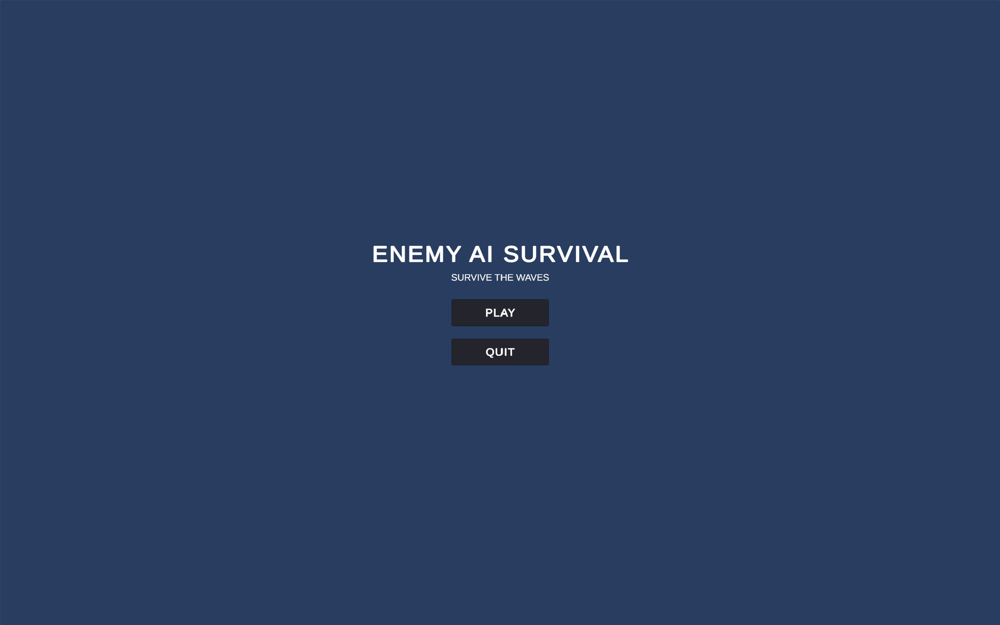
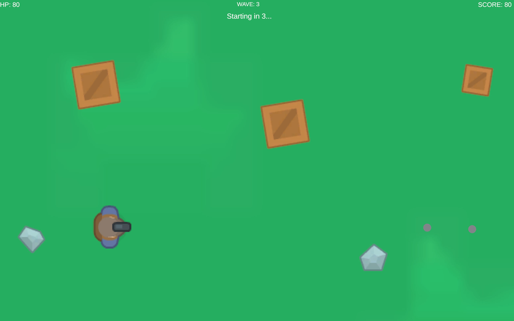
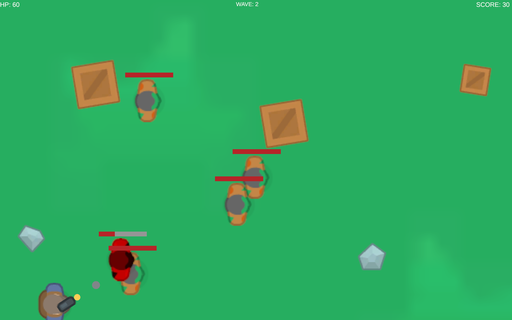

# Enemy AI Survival

A 2D top-down survival game developed using Unity and C#.

The player must survive increasingly difficult waves of enemies while using movement, shooting, and the environment to stay alive.

## Gameplay







## Features

- Player movement using keyboard controls
- Mouse-directed shooting
- Enemy AI with idle, chase, and attack behaviors
- Distance-based enemy detection
- Obstacle avoidance using raycasts
- Enemy health bars
- Damage and hit feedback
- Knockback mechanics
- Wave-based enemy spawning
- Increasing enemy count between waves
- Score system
- Player health system
- Game-over and restart system
- Main menu

## Enemy AI

Enemies use three basic behaviors:

```text
Idle
  ↓
Chase
  ↓
Attack
```

When the player is outside the detection range, the enemy remains idle.

When the player enters the detection range, the enemy moves toward the player.

When the enemy gets close enough, it attacks the player.

During chasing, raycasts are used to detect obstacles and select an alternate movement direction.

## Technologies

- C#
- Unity
- Unity 2D Physics
- TextMesh Pro
- Git
- GitHub

## Controls

| Input | Action |
|---|---|
| WASD / Arrow Keys | Move |
| Mouse | Aim |
| Left Mouse Button | Shoot |

## Project Structure

```text
EnemyAISurvival/
├── Assets/
├── Packages/
├── ProjectSettings/
├── Screenshots/
├── README.md
└── .gitignore
```

## How to Run

1. Clone or download the repository.
2. Open the project using Unity Hub.
3. Open the `MainMenu` scene.
4. Press Play.
5. Select `PLAY` to start the game.

## Author

Anish Bandaru
